## 大学生创新创业计划书

项目名称："智讲"——基于多模态AI的高校师范生试讲智慧训练系统

所在班级：___

学生学号：___

学生姓名：___

撰写日期：___ 年 月 日

## 目 录

第一章 项目摘要

1.1 产品介绍

1.2 市场分析

1.3 盈利模式

1.4 风险管理

第二章 公司概况

2.1 公司介绍

2.2 公司目前职工情况

2.3 组织架构

2.4 公司宗旨

第三章 市场分析

3.1 行业背景概述

3.2 目标客户

3.3 目标客户面临问题

3.4 行业发展趋势

3.5 竞争分析

第四章 产品与技术分析

4.1 产品概述

4.2 产品核心技术优势

4.3 产品可行性分析

第五章 商业模式

5.1 商业模式概述

5.2 商业模式画布

5.3 盈利模式

5.4 未来发展

第六章 营销策略

6.1 主要推广策略

第七章 财务分析

7.1 公司财务基本情况与资金使用计划

7.2 销售预计表

7.3 成本费用核算

7.4 利润表

7.5 财务分析

## 第一章 项目摘要

### 1.1 产品介绍

当前我国高等师范教育正面临一个结构性矛盾：师范生在校人数已突破300万，而指导教师数量增长有限，一位导师通常需要指导20至40名学生。每轮试讲作业包含教案文档和10至15分钟的试讲视频，人工逐一批改每人需要20至30分钟，一轮批改耗费数天甚至一周以上。与此同时，传统评价以主观判断为主，缺乏统一量化标准，学生也缺少模拟课堂互动的备课训练手段。

针对上述问题，项目利用大语言模型与多模态人工智能技术，构建了线上智慧试讲训练平台——"智讲"。系统将社会上已经成熟的AI文本分析、语音识别和视觉理解能力整合到师范教育的具体场景中，围绕"教案智能分析—试讲视频多模态评估—AI对话式备课—AI辅助批改—学生成长画像"五个环节形成完整的训练闭环。系统支持管理员、指导老师、学生三种角色的差异化使用，通过Docker容器化方式部署于自有服务器，已完成全部功能开发并上线试运行，覆盖33个功能页面和80余个API接口。

### 1.2 市场分析

根据教育部统计数据和行业研究报告，全国现有师范类高校200余所，开设教育类专业的综合性高校400余所，在校师范生约300万人，指导教师约5万人。随着《教育部教育信息化2.0行动计划》《新时代基础教育强师计划》等政策的持续推进，以及2024年政府工作报告首次提出"人工智能+"行动，AI赋能师范教育的市场需求正在快速增长。目前国内外尚无一款产品能够将AI教案分析、多模态视频评估、对话式备课训练、教务管理闭环和成长画像追踪集成于一体，本项目定位于这一精准细分领域，市场空白明显，先发优势显著。

### 1.3 盈利模式

项目盈利模式有三类：

**1. SaaS订阅收入**

按学院和年度向高校师范学院收取系统使用订阅费用，包含系统使用权、AI调用额度和技术支持服务。这是项目的基础收入来源，适合中小规模院校。按全国600余所相关院校估算，即使初期渗透率仅为5%，年订阅收入也相当可观。

**2. 私有化部署与定制服务收入**

为对数据安全性和个性化要求较高的大型院校提供Docker私有化部署方案，可根据院校需求定制评价维度、Rubric评分标准配置和系统界面。此类服务以项目制收费，单价较高，利润率可观。

**3. AI能力开放与技术授权收入**

将教案分析API、视频多模态分析API作为独立服务向其他教育平台和培训机构开放，按调用量收费。随着AI+教育市场的扩大，此类收入具有较强的增长潜力。

### 1.4 风险管理

#### 1.4.1 技术风险

（1）风险识别

系统的AI能力依赖第三方大模型API（通义千问系列），存在服务中断、模型升级导致接口变化、以及AI分析结果准确性波动等技术风险。此外，视频分析涉及较大的计算资源消耗，Token成本可能超出预算。

（2）风险管理措施

在服务可用性方面，系统设计了多服务商热切换机制，通过环境变量配置即可在通义千问、DeepSeek和OpenAI兼容接口之间无缝切换，不修改一行业务代码。同时，AI服务层与业务层采用抽象解耦设计，当AI功能不可用时自动降级，不影响教务管理等基础功能的正常使用。在分析准确性方面，采用"AI先行分析+老师审核确认"的人机协同模式，AI的输出始终作为"建议"而非"决定"，教师保留最终判断权。评分标准支持通过Rubric配置动态调整，可根据实际使用反馈持续优化。在成本控制方面，每次AI调用都记录token_usage并汇入运营看板，支持配置用量阈值告警，同时设置最大输入长度限制以防止异常消耗。

#### 1.4.2 管理风险

（1）风险识别

项目创立初期团队规模有限，在产品迭代、用户支持和市场推广等方面可能面临人力不足的压力。同时，作为面向高校的教育信息化产品，需要与学校行政体系对接，推广周期可能较长。

（2）风险管理措施

在团队建设方面，充分发挥团队成员跨学科（计算机+教育学）的协作优势，建立清晰的分工体系和项目管理流程。在推广策略方面，采用渐进式推广路径——先在本校师范学院试点积累数据和口碑，再通过教育信息化联盟向区域内高校扩展，最后依托竞赛成果和用户案例向全国推广。每个阶段设定明确的里程碑指标，确保资源投入的节奏可控。

#### 1.4.3 市场风险

（1）风险识别

尽管目前该细分领域尚无直接竞品，但互联网大厂和教育科技公司具备资金和技术优势，一旦看到市场机会可能快速入局。此外，教育政策的调整也可能影响市场需求和产品定位。

（2）风险管理措施

在竞争壁垒方面，项目通过五大技术创新点（多模态深度融合、可解释维度化评价、首创角色扮演式备课助手、画像快照过程性评价、三端AI全覆盖）构建差异化竞争力。同时，系统已取得软件著作权，知识产权保护到位。在市场敏感度方面，团队持续关注教育信息化政策动向和AI技术发展趋势，保持产品迭代的灵活性。在用户粘性方面，系统的成长画像功能会随着学生使用时间的增长积累越来越丰富的能力数据，形成数据壁垒，迁移成本较高，有助于增强用户粘性。

#### 1.4.4 数据安全风险

（1）风险识别

学生的教案文档和试讲视频涉及个人学业信息，高校对数据安全和隐私保护有较高要求。如果数据泄露或被不当使用，将严重损害项目声誉和用户信任。

（2）风险管理措施

系统支持Docker私有化部署，确保数据不出校园网，从根本上消除数据外泄的风险。在技术层面，采用JWT鉴权配合角色级权限控制保证访问安全，HTTPS加密传输保护数据在网络中的安全性，API密钥等敏感信息严格不入代码仓库。在制度层面，与合作院校签署数据安全协议，明确数据所有权归属和使用范围。

## 第二章 公司概况

### 2.1 公司介绍

"智讲"教育科技团队成立于2024年9月，由（请填写学校名称）在校学生组建。团队以"用多模态AI技术重塑师范生试讲训练"为使命，致力于开发面向高校师范学院的智慧试讲训练系统。经过六个多月的研发，团队已完成系统的全部核心功能开发、Docker容器化部署和服务器上线试运行，并已申请软件著作权《高校师范生试讲智慧管理系统》。

### 2.2 公司目前职工情况

（请根据实际情况填写）

| 角色 | 姓名 | 专业/年级 | 主要职责 |
| --- | --- | --- | --- |
| 项目负责人 | （请填写） | （请填写） | 项目统筹、系统设计、核心开发 |
| 技术负责人 | （请填写） | （请填写） | 后端架构、AI服务集成、数据库设计 |
| 前端开发 | （请填写） | （请填写） | 前端界面开发、交互设计、数据可视化 |
| 产品与测试 | （请填写） | （请填写） | 需求调研、产品设计、系统测试 |
| 指导教师 | （请填写） | （请填写） | 技术指导、教育领域专业指导 |

团队成员的专业背景覆盖计算机科学、软件工程与教育学，具备跨学科协作能力，在Web全栈开发和AI应用开发方面积累了丰富的实践经验。

### 2.3 组织架构

图 2-1 团队组织架构

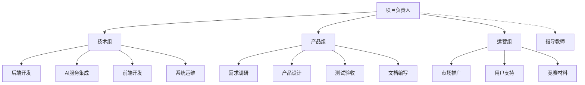

团队采用扁平化管理结构，项目负责人统筹全局，下设技术组、产品组和运营组三个职能模块。技术组负责前后端开发、AI服务集成和系统运维；产品组负责需求调研、产品设计、测试验收和文档编写；运营组负责市场推广、用户支持和竞赛材料准备。各组之间通过每周例会和即时通讯保持高效协作。

### 2.4 公司宗旨

项目的核心使命是通过多模态AI技术赋能师范教育，让每一位师范生都能获得及时、专业、个性化的试讲训练反馈。项目属于教育信息化公益事业与商业化运营相结合的模式，社会效益明显——减轻指导教师批改负担，缓解师范教育中师生比失衡的结构性矛盾，推动教育评价从"主观经验"向"数据驱动"转变，最终提升未来教师的培养质量，让更多基础教育阶段的学生受益于更高素质的师资队伍。

## 第三章 市场分析

### 3.1 行业背景概述

#### 3.1.1 师范教育规模持续扩大，师资培养压力凸显

进入21世纪以来，我国高度重视教师队伍建设。全国师范类本科招生规模持续扩大，2024年师范生在校人数已突破300万，较十年前增长了近一倍。然而，高校指导教师的数量增长远远跟不上学生规模的扩张。据调研统计，当前一位指导教师通常需要同时指导25至35名师范生，部分院校甚至达到40人以上。试讲训练作为师范生教学能力培养的核心实践环节，需要教师对每位学生的教案和试讲视频进行逐一批改和反馈，工作量极为繁重。按每人20至30分钟的批改时间计算，指导30名学生的一轮批改至少需要10至15个小时的纯工作量，加上备课和反馈沟通的时间，实际投入更大。这种高强度的工作负荷不仅影响了教师的教学质量，也导致学生获得反馈的等待周期过长，平均达到5至10天，严重削弱了训练的时效性。

表 3-1 我国师范生在校人数增长趋势

| 年份 | 2018年 | 2019年 | 2020年 | 2021年 | 2022年 | 2023年 | 2024年 |
| --- | --- | --- | --- | --- | --- | --- | --- |
| 在校师范生(万人) | 180 | 200 | 220 | 240 | 260 | 280 | 300+ |
| 增长率 | — | 11.1% | 10.0% | 9.1% | 8.3% | 7.7% | 7.1% |

图 3-1 师范生在校人数逐年增长（单位：万人）

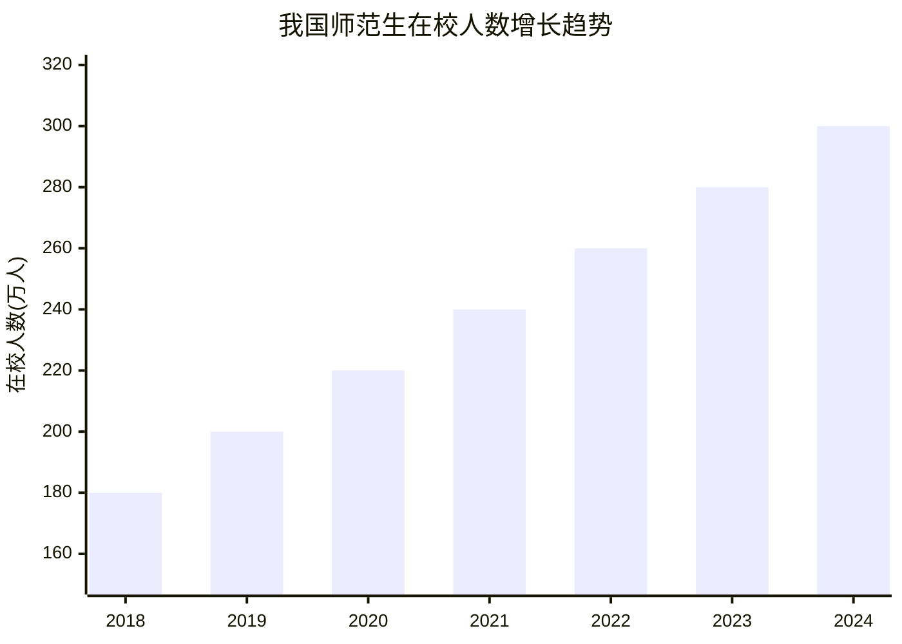

图 3-2 师范教育师生比矛盾示意

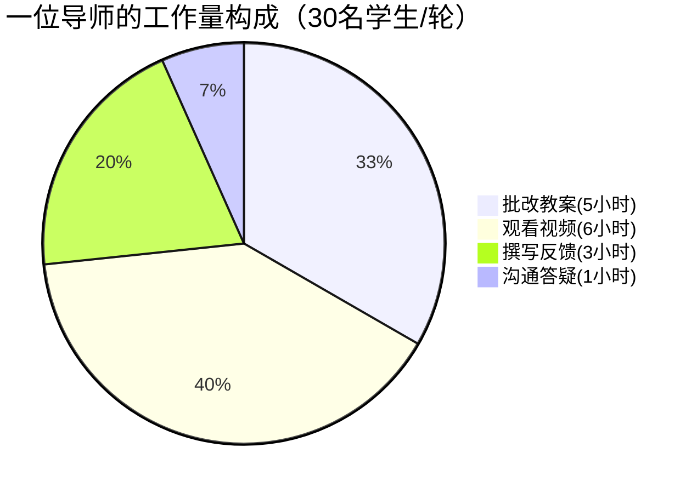

#### 3.1.2 教育评价改革对过程性评价提出迫切需求

长期以来，我国师范生试讲训练的评价方式以"终结性评价"为主——教师在学生试讲结束后给出一个总体分数和简短评语，缺乏对训练过程中多维度能力变化的持续记录和分析。《关于深化新时代教育评价改革总体方案》明确提出"改进结果评价，强化过程评价"的要求，但目前绝大多数高校的试讲训练管理系统仅支持成绩录入功能，不具备结构化数据采集和可视化分析能力，无法支撑过程性评价的落地实施。学生无法追踪自己在多次试讲中的能力变化趋势，教师也难以基于数据为学生提供个性化的指导建议。

图 3-3 传统评价方式与本系统评价方式对比

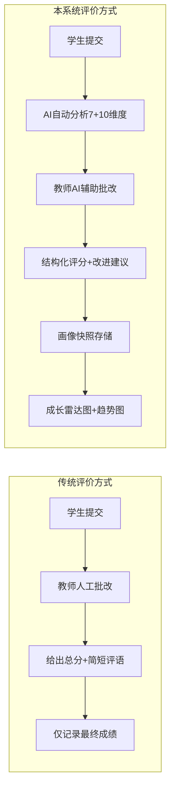

#### 3.1.3 国家政策大力推动AI与教育深度融合

近年来，国家出台了一系列重大政策为AI赋能教育提供战略支撑。《教育部教育信息化2.0行动计划》要求"推动人工智能在教学、管理、资源建设等全流程应用"。《新时代基础教育强师计划》强调"改革师范生培养模式，强化教学实践能力训练"。2024年政府工作报告首次提出"人工智能+"行动，将AI与各行业深度融合提升至国家战略高度。这些政策为AI+师范教育训练工具的发展提供了明确的方向指引和良好的政策环境。

#### 3.1.4 大模型技术成熟为教育AI应用奠定基础

2023至2025年间，大语言模型和多模态AI技术取得了里程碑式的突破。以通义千问为代表的国产大模型在文本分析、语音理解和视觉识别等方面已达到可用于生产环境的成熟度。更重要的是，这些能力通过标准化的API接口对外开放，开发者无需自建GPU集群即可集成使用，大幅降低了AI应用的开发门槛和部署成本。这使得构建一个覆盖"文本+语音+视觉"的多模态教育AI系统从技术上完全可行，且经济上可承受。

### 3.2 目标客户

项目的目标客户群体涵盖三个层面。第一层面是高校师范学院的教务管理人员，全国共有600余所相关院校，他们需要高效的教务管理工具和全局数据看板来支撑教学管理决策。第二层面是约5万名师范生指导教师，他们承受着繁重的批改压力，迫切需要AI辅助工具来提升批改效率和评价质量。第三层面也是最大的用户群体，即约300万名在校师范生，他们需要AI辅助备课工具、及时的训练反馈和可视化的能力成长追踪。

此外，本系统的技术底座具备向相邻场景延伸的能力。教师资格证考试培训机构、新教师入职培训项目、各级教学竞赛组织方等，都是潜在的目标客户。

### 3.3 目标客户面临问题

#### 3.3.1 教师端面临的问题

项目团队对多所高校师范学院进行了深入调研，发现指导教师面临的核心困境是批改效率低下与评价标准难以统一的双重压力。调研数据显示，仅有23%的教师对当前批改效率表示满意，87%的教师认为评价标准需要统一。每份作业包含教案文档（通常5至15页）和试讲视频（10至15分钟），教师需要完整阅读教案、观看视频后才能给出有针对性的反馈。以一所拥有200名师范生和8名指导教师的学院为例，每轮试讲批改的总人工成本约为100至150小时。在评价标准方面，不同教师的评价重点存在明显差异——有的侧重教案结构，有的关注教态表现，有的偏重知识准确性，同一份教案可能被不同教师评出20分以上的分差。92%的教师明确表示希望获得AI辅助批改工具。

图 3-4 教师端调研数据

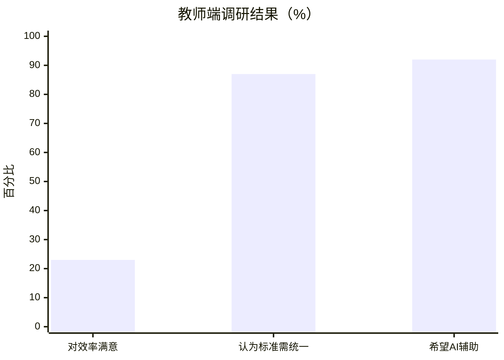

#### 3.3.2 学生端面临的问题

师范生面临的主要问题是反馈等待时间长、反馈内容不够具体以及备课训练缺乏互动。76%的学生认为收到的反馈不够具体和可操作，89%希望获得量化的评价指标而非笼统的印象分。最为突出的问题是备课训练缺乏互动场景——94%的学生反映在正式试讲前缺少模拟课堂互动的练习机会。师范生备课主要依赖"写教案—自己练读—同学互评"的传统模式，无法体验被学生追问、质疑、走神等真实课堂情境，课堂应变能力难以得到有效锻炼。91%的学生表示希望能够追踪自身的能力成长轨迹，了解自己在多次试讲中到底有没有进步、哪些方面在进步、哪些方面仍然薄弱。

图 3-5 学生端调研数据

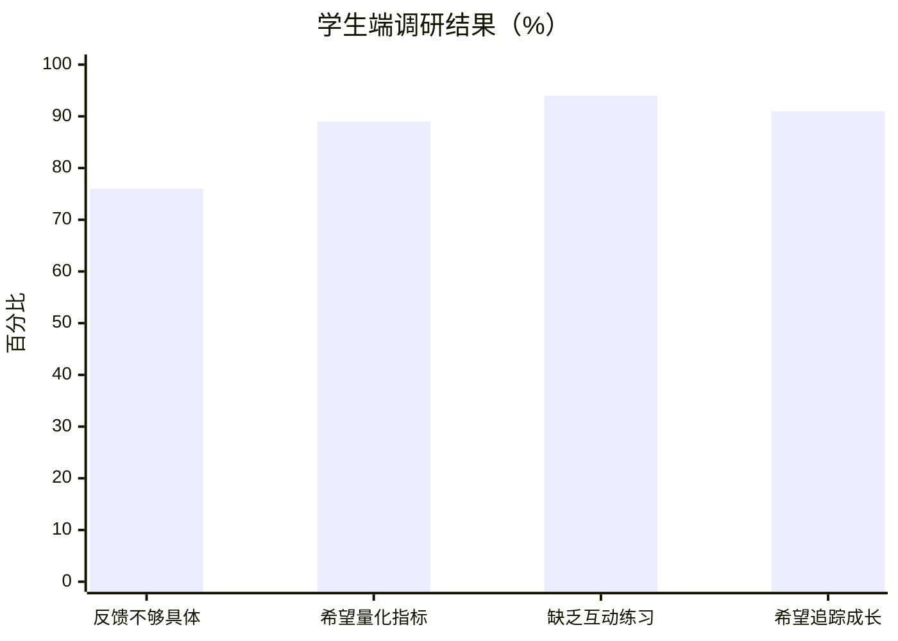

#### 3.3.3 管理端面临的问题

教务管理人员面临的问题主要集中在管理流程繁琐和数据支撑不足两个方面。85%的管理人员反映当前教务管理流程依赖手工统计，效率低下。78%表示缺乏全局数据监控看板，无法实时掌握各批次的试讲训练进度。82%表示无法进行跨批次的教学质量对比分析，难以评估教学改革措施的实际效果。

### 3.4 行业发展趋势

从宏观环境来看，我国AI+教育市场规模在2025年预计超过500亿元，其中师范教育信息化是增长最快的细分领域之一。政策层面的持续推动、技术层面的不断成熟和需求层面的日益迫切，三重因素叠加形成了强劲的市场驱动力。

从行业趋势来看，教育AI正从"通用工具"向"场景化深度应用"演进。早期的教育AI产品以通用型聊天机器人和简单的自动评分为主，缺乏对具体教育场景的深度适配。而市场真正需要的是能够融入教学全流程、理解具体学科和教学法要求、提供可解释和可追踪的分析结果的专业化产品。本项目正是沿着这一趋势方向，将多模态AI技术与师范试讲训练这一具体场景进行深度融合。

从评价方式来看，教育评价正从"终结性评价"向"过程性评价"转变。这要求系统不仅能记录最终成绩，还能持续采集多维度能力数据、形成时间序列的成长轨迹、并基于数据自动生成个性化建议。本项目的成长画像功能正是为这一趋势而设计。

### 3.5 竞争分析

目前市场上与本项目存在间接竞争关系的产品主要有三类。第一类是以超星学习通、雨课堂为代表的传统教务系统，它们具备作业收发和手动评分功能，但完全不具备AI分析能力，无法减轻教师的批改负担。第二类是以ChatGPT、文心一言为代表的通用AI工具，它们虽然具备文本理解能力，但缺乏教案评价的专业维度体系，与教务管理流程完全隔离，教师需要在多个工具间来回切换复制粘贴。第三类是以讯飞智教为代表的语音视频分析产品，其分析维度面向客服质检或通用演讲场景，与教师试讲的专业需求不匹配。

本项目的核心竞争优势在于五个方面：其一，多模态AI深度融合教育场景，实现文本、语音、视觉三种模态的跨模态数据融合而非简单功能堆叠；其二，可解释的维度化评价体系，教案七维度、视频多指标，每个评分都有据可查；其三，首创"角色扮演式"AI备课助手，目前国内外无同类产品；其四，基于画像快照的过程性评价闭环，填补了传统系统的评价空白；其五，三端（学生端、教师端、管理员端）均深度融合AI，每个角色都能实质性受益。此外，系统支持Docker私有化部署，而竞品大多只能以SaaS方式使用，在数据安全性和可控性方面存在明显差距。

表 3-2 竞品功能对比矩阵

| 对比维度 | 超星/雨课堂 | ChatGPT/文心 | 讯飞智教 | **智讲（本系统）** |
| --- | --- | --- | --- | --- |
| 教案智能分析 | ❌ | △通用对话 | ❌ | **✅七维度结构化** |
| 视频多模态评估 | ❌ | ❌ | △非教育场景 | **✅语音+视觉** |
| AI备课互动 | ❌ | △通用对话 | ❌ | **✅角色扮演式** |
| 教务管理闭环 | ✅ | ❌ | ❌ | **✅完整三端** |
| 成长画像追踪 | ❌ | ❌ | ❌ | **✅雷达+趋势+建议** |
| AI辅助批改 | ❌ | △需手动粘贴 | ❌ | **✅五项一键AI** |
| AI运营治理 | ❌ | ❌ | ❌ | **✅监控+告警** |
| 私有化部署 | ❌ | ❌ | ❌ | **✅Docker** |

图 3-6 竞品能力覆盖对比雷达图

## 第四章 产品与技术分析

### 4.1 产品概述

#### 4.1.1 产品介绍

"智讲"是一款基于多模态AI技术的高校师范生试讲智慧训练系统。系统采用Vue 3 + FastAPI + MySQL前后端分离的B/S架构，AI能力层集成通义千问系列三款专业模型——文本模型qwen-plus负责教案分析与生成，音频模型qwen-omni-turbo负责语音维度分析，视觉模型qwen-vl-max负责教态视觉分析——构建起覆盖文本、语音、视觉三种模态的AI能力中台。

图 4-1 系统功能结构图

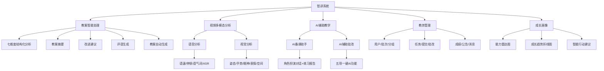

系统包含五大核心功能模块。教案智能处理模块实现教案七维度结构化分析（结构完整性、教学目标、重难点分析、教学过程、教学方法、板书设计、语言表达）、教案摘要、改进建议、评语生成和教案自动生成。视频多模态分析模块实现语音分析（语速、停顿、语气词、语音转文字）和视觉分析（姿态、手势、眼神、表情、空间运用）。AI辅助教学模块包含AI备课助手（角色扮演对话+练习报告）和AI辅助批改（五项一键AI功能）。教务管理模块涵盖用户、批次、分组、任务、提交、批改、成绩、公告、消息等完整闭环。成长画像模块提供能力雷达图、成长趋势折线图和智能行动建议。

图 4-2 系统技术架构图

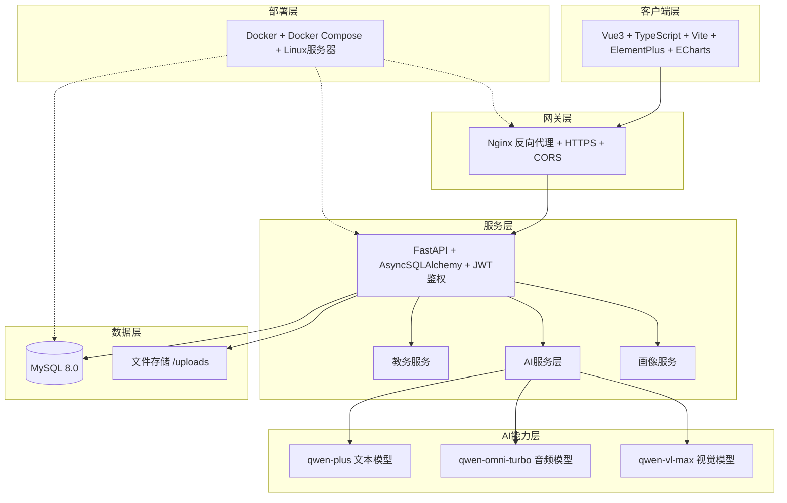

系统已完成开发并部署上线，覆盖学生端12个功能页面、教师端6个功能页面、管理员端15个功能页面，累计开发API接口80余个、数据库表12张以上。

#### 4.1.2 使用说明

图 4-3 系统使用流程图

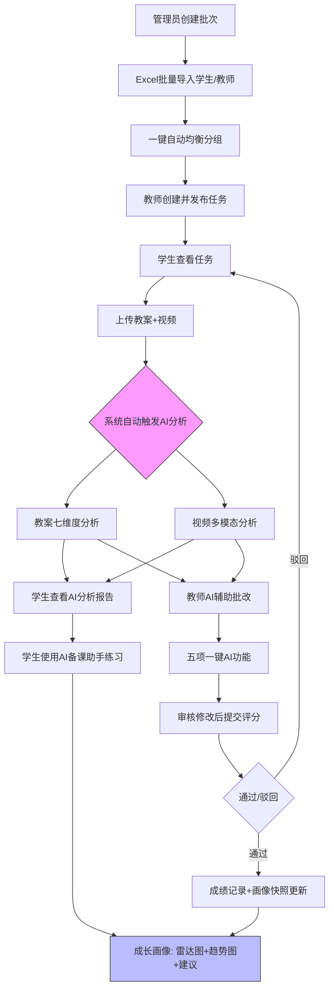

系统的使用流程形成完整闭环。管理员登录后创建批次并通过Excel批量导入学生和教师信息，使用一键自动均衡分配功能完成分组。教师创建试讲任务并发布，学生端即时可见。学生上传教案（PDF/DOC/DOCX格式）和试讲视频（MP4/MOV格式），系统自动触发AI分析。学生可以立即在"AI分析报告"页面查看教案七维度评分和视频多模态评估结果，在"AI备课助手"页面选择年级和性格进行模拟课堂对话练习并生成报告，在"成长画像"页面追踪能力变化趋势。教师进入"作业批改"页面后，上方自动展示视频分析结果，中间是教案预览和视频播放区，通过右侧AI下拉按钮一键调用AI分析、AI摘要、改进建议、AI评语和AI综合评语五项辅助功能，AI预生成内容自动填入评分表单，教师审核修改后提交评分。管理员通过全局监控、数据大屏和AI运营看板掌握全局状态。

### 4.2 产品核心技术优势

#### 4.2.1 多模态AI深度融合的技术独创性

本系统最核心的技术优势在于实现了文本、语音、视觉三种AI模态在同一教育场景中的深度融合。系统通过统一的JSON数据模型将三款专业模型的分析结果进行关联存储——教案文本分析结果存入Submission表的lesson_plan_analysis字段，视频分析结果存入video_analysis字段，备课助手练习报告存入practice_sessions——最终在成长画像模块汇聚，进行跨模态综合计算。学生可以在同一张ECharts雷达图上同时看到"写（教案7个维度）、讲（视频3个维度）、练（互动1个维度）"共11个维度的能力分布，这是真正的跨模态数据融合而非功能拼凑。

目前市场上的竞品最多只涉及单一模态（纯文本分析或纯语音分析），没有任何产品实现了文本+语音+视觉三种模态在教育场景中的协同分析和数据融合。

#### 4.2.2 可解释评价体系的专业性

系统的评价体系完全基于师范教育领域的专业标准设计。教案分析的七个维度、每个维度的评分标准和权重都来自教案评价的学术研究和教学实践，通过Prompt Engineering注入大语言模型。每个维度不仅给出0到100的量化评分，还附带评价说明、亮点和改进建议，做到"分从何来、改往何去"。视频分析的指标（语速、停顿、语气词、姿态、手势、眼神、表情、空间运用）同样来自师范教育领域对"教态"的专业定义，每个指标附带理想范围和针对性建议。评分权重支持通过Rubric配置进行动态调整，不同院校和学科可以根据自身需要定制评价标准。

#### 4.2.3 首创功能的市场引领性

AI备课助手的"角色扮演式"设计在国内外教育AI领域属于首创。通过System Prompt精确控制AI的年级认知水平边界和性格特征，配合五种提问策略（基础理解、深入追问、拓展延伸、实际应用、常见错误）的概率分布调控，对话采用fetch API实现流式输出模拟真实课堂节奏，练习结束后自动生成结构化报告。这一功能为师范生提供了一种全新的备课训练范式，填补了"备课缺乏互动"这一长期存在的痛点。

### 4.3 产品可行性分析

#### 4.3.1 技术可行性

系统的技术栈全部基于成熟的开源框架和商用API。前端采用Vue 3 + TypeScript + Vite + Element Plus + ECharts，后端采用FastAPI + Async SQLAlchemy + MySQL 8.0，AI能力通过通义千问系列模型的标准化API接口调用，部署通过Docker + Docker Compose实现容器化。所有技术组件都经过大规模生产环境验证，技术风险极低。系统已完成全部开发并上线运行，充分证明了技术方案的可行性。

#### 4.3.2 市场可行性

根据调研数据，92%的指导教师希望获得AI辅助批改工具，94%的师范生反映缺乏互动练习机会，91%的学生希望追踪能力成长——市场需求明确且迫切。同时，目前该细分领域尚无直接竞品，先发优势显著。国家政策持续推动AI与教育深度融合，为产品推广提供了良好的政策环境。

#### 4.3.3 经济可行性

系统的AI能力通过API远程调用云端大模型，不依赖本地GPU资源，部署硬件要求仅为4核CPU、8GB内存、100GB硬盘的普通服务器，单校部署成本极低。AI调用成本随着大模型价格的持续下降而不断降低，项目的经济可行性将进一步增强。同时，系统通过token_usage实时监控和阈值告警机制确保AI成本可控。

#### 4.3.4 政策可行性

《教育部教育信息化2.0行动计划》明确要求推动AI在教学全流程应用。《新时代基础教育强师计划》强调强化师范生教学实践能力训练。2024年政府工作报告首次提出"人工智能+"行动。这些政策为本项目提供了坚实的政策依据和发展方向，产品与政策方向高度契合。

## 第五章 商业模式

### 5.1 商业模式概述

图 5-1 商业模式三方关系示意图

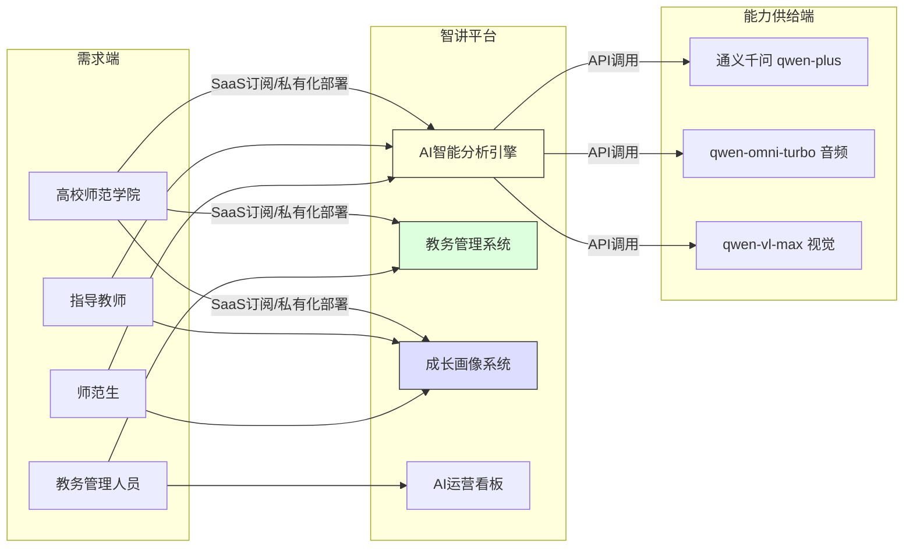

项目以"智讲"互联网试讲训练平台为核心，采用"平台+服务"的商业模式。平台层面，为高校师范学院提供集AI智能分析、教务管理和数据看板于一体的一站式解决方案，学院按年度订阅使用。服务层面，为有个性化需求的院校提供私有化部署、评价标准定制和技术培训等增值服务。技术层面，将教案分析API和视频分析API作为独立能力向第三方教育平台开放。

与传统教育信息化产品的纯SaaS模式不同，本项目同时支持SaaS和私有化部署两种模式，以适应不同院校在数据安全和个性化方面的差异化需求。AI能力来自云端大模型API调用，使平台本身保持轻量化，无需自建AI基础设施，有效控制运营成本。

### 5.2 商业模式画布

<table><tr><td rowspan="2">重要合作 通义千问/DeepSeek等AI模型服务商提供AI能力 高校师范学院提供应用场景和用户基础 教育信息化联盟提供推广渠道</td><td>关键业务 AI模型Prompt工程与持续优化 系统开发迭代与运维 用户支持与培训</td><td colspan="2" rowspan="2">价值主张 将师范生试讲训练中的"教案质量+试讲表现+互动能力"做成可量化、可解释、可追踪的训练闭环，实现从"经验评价"到"数据驱动评价"的范式转变</td><td>客户关系 通过系统平台与客户建立长期服务关系 学生使用产生数据粘性 成长画像随使用时间积累价值</td><td rowspan="2">客户细分 核心用户：高校师范生（约300万） 关键决策者：学院教务管理人员 重要使用者：指导教师（约5万）</td></tr><tr><td>核心资源 多模态AI技术能力 师范教育领域知识 软件著作权 用户数据积累</td><td>渠道通路 本校试点推广 教育信息化联盟 竞赛成果背书 行业展会与学术会议</td></tr><tr><td colspan="3">成本构成 AI模型API调用费用、服务器运维费用、人员薪酬、市场推广费用</td><td colspan="3">收入来源 SaaS年度订阅费、私有化部署服务费、AI API调用费、技术培训费</td></tr></table>

### 5.3 盈利模式

项目盈利模式有三类：

**1. SaaS订阅收入**

按学院和年度向高校师范学院收取订阅费用，包含系统使用权、AI调用额度（按Token/音频秒数计量）和基础技术支持。定价策略根据院校师范生规模分为标准版和专业版。这是项目的基础收入来源和主要增长引擎。

**2. 私有化部署与定制服务收入**

为对数据安全性要求较高的院校提供Docker私有化部署方案，一次性收取部署费用加年度维护费。可根据院校需求定制评价维度（Rubric配置）、系统界面和功能模块。此类收入单价较高，利润率可观。

**3. AI能力开放收入**

将教案分析API、视频分析API作为独立服务向教师资格证培训机构、新教师入职培训平台等第三方开放，按API调用量收费。随着AI+教育生态的扩大，此类收入具有长期增长潜力。

### 5.4 未来发展

项目的短期任务是在本校师范学院完成实际课程试运行，积累真实应用数据和用户口碑，打磨产品体验，为后续推广奠定基础。

中期目标是力争在2到3年内覆盖区域内10至20所高校，建立稳定的用户基础和品牌认知。在功能层面持续优化AI分析精度，接入更多先进大模型，完善数据大屏和运营看板能力，形成标准化的交付和服务流程。

长期愿景是将"智讲"打造为AI赋能师范教育的全国性平台，覆盖全国数百所师范院校和教育类院校。在场景层面向教师资格证培训、新教师入职培训、教学竞赛辅助等相邻领域拓展，构建AI+教师教育的生态体系。在技术层面持续积累用户数据，利用数据反馈优化评价模型，形成数据壁垒和算法优势。

## 第六章 营销策略

### 6.1 主要推广策略

#### 6.1.1 校内试点推广

项目推广的第一步是在本校师范学院进行实际课程试运行。通过与学院教务部门合作，将系统嵌入到试讲训练的常规教学流程中，让教师和学生在真实教学场景中体验系统功能。试运行期间免费提供全部功能，重点收集用户反馈和应用数据，用真实的效率提升数据（如批改时间缩短、反馈周期缩短等）形成有说服力的案例材料。

#### 6.1.2 竞赛成果背书

参加"挑战杯"等全国性大学生科技竞赛，以获奖成果作为产品品质和创新性的权威背书。竞赛获奖不仅能提升项目在高校圈层的知名度和可信度，还能建立与各地高校的联系渠道，为后续推广打开局面。

#### 6.1.3 教育信息化联盟渠道

通过加入省级和全国性的教育信息化联盟、师范院校合作网络，借助联盟平台进行产品展示和推介。教育信息化联盟的成员单位通常有定期的交流会议和技术展示活动，这是触达目标院校决策者的高效渠道。

#### 6.1.4 学术会议与行业展会

在教育技术、师范教育、人工智能与教育等方向的学术会议上发表论文或做产品展示，在教育信息化行业展会上设置展位，面向高校教务管理人员和一线教师进行推广。通过学术渠道建立专业形象，增强目标客户的信任度。

#### 6.1.5 新媒体内容营销

在微信公众号、知乎、B站等平台发布AI+教育方向的深度内容，包括产品功能演示视频、用户使用案例、AI教育技术解读等。通过持续的内容输出建立品牌专业形象，吸引目标用户主动关注和咨询。

#### 6.1.6 口碑裂变推广

系统的核心用户是师范生和指导教师，他们在学术圈和教育圈具有天然的社交网络。通过提供优质的产品体验和用户服务，激发用户的口碑传播意愿。同时，成长画像等功能具有天然的社交分享属性——学生可以分享自己的能力雷达图和成长趋势，形成自发传播效应。

## 第七章 财务分析

### 7.1 公司财务基本情况与资金使用计划

项目初期计划总投资8万元，具体投资情况如下：

| 序号 | 项目 | 资金(万元) | 比例(%) |
| --- | --- | --- | --- |
| 1 | AI模型API调用费用（首年额度） | 2.0 | 25.00% |
| 2 | 服务器租赁与运维（首年） | 1.5 | 18.75% |
| 3 | 软件著作权及知识产权费用 | 0.5 | 6.25% |
| 4 | 营销推广费用 | 1.5 | 18.75% |
| 5 | 竞赛参赛及差旅费用 | 0.5 | 6.25% |
| 6 | 流动资金 | 2.0 | 25.00% |
| | 合计 | 8.0 | 100.00% |

编制说明：初期运作资金主要用于AI模型API调用额度的采购（保障系统正常运行所需的Token和音频分析额度）、云服务器的租赁与运维、软件著作权申请、早期营销推广以及必要的流动资金储备。由于系统开发已基本完成，不再需要大额的软件开发投入。AI模型的调用成本随着大模型价格的持续下降预计将逐年降低。

### 7.2 销售预计表

| 序号 | 项目 | T+1年 | T+2年 | T+3年 | T+4年 | T+5年 |
| --- | --- | --- | --- | --- | --- | --- |
| 1 | SaaS订阅收入(万元) | 10 | 30 | 60 | 100 | 150 |
| 2 | 私有化部署收入(万元) | 5 | 10 | 20 | 30 | 40 |
| 3 | AI API开放收入(万元) | 0 | 5 | 10 | 20 | 30 |
| 4 | 合计 | 15.0 | 45.0 | 90.0 | 150.0 | 220.0 |

编制说明：第一年（T+1）以校内试点和区域推广为主，预计覆盖5至10所院校，SaaS订阅和少量私有化部署带来15万收入。第二年覆盖范围扩展到20至30所院校，同时AI API开放收入开始产生。第三年起进入全国推广阶段，收入增速加快。第五年预计覆盖80至100所院校，年收入达到220万。收入增长假设基于保守的市场渗透率估算（全国600余所相关院校中渗透约15%）。

### 7.3 成本费用核算

| 序号 | 项目 | T+1年 | T+2年 | T+3年 | T+4年 | T+5年 |
| --- | --- | --- | --- | --- | --- | --- |
| 1 | AI模型API调用成本 | 3.0 | 7.0 | 12.0 | 18.0 | 25.0 |
| 2 | 服务器与运维成本 | 2.0 | 3.0 | 5.0 | 8.0 | 12.0 |
| 3 | 人员薪酬 | 6.0 | 12.0 | 20.0 | 30.0 | 40.0 |
| 4 | 营销推广费用 | 2.0 | 4.0 | 6.0 | 8.0 | 10.0 |
| 5 | 其他管理费用 | 1.0 | 2.0 | 3.0 | 4.0 | 5.0 |
| 6 | 总成本费用 | 14.0 | 28.0 | 46.0 | 68.0 | 92.0 |

编制说明：AI模型API调用成本按收入的20%至12%估算（随规模效应和模型降价逐年降低比例）。服务器成本随用户规模增长而增长。人员薪酬假设团队从初期5人逐步扩展到15人（含开发、运营和销售）。营销推广费用约占收入的10%至5%。

### 7.4 利润表

| 序号 | 项目 | T+1年 | T+2年 | T+3年 | T+4年 | T+5年 |
| --- | --- | --- | --- | --- | --- | --- |
| 1 | 主营业务收入 | 15.0 | 45.0 | 90.0 | 150.0 | 220.0 |
| 2 | 总成本费用 | 14.0 | 28.0 | 46.0 | 68.0 | 92.0 |
| 3 | 税收及附加 | 0.5 | 1.5 | 3.0 | 5.0 | 7.3 |
| 4 | 利润总额 | 0.5 | 15.5 | 41.0 | 77.0 | 120.7 |
| 5 | 所得税(25%) | 0.1 | 3.9 | 10.3 | 19.3 | 30.2 |
| 6 | 净利润 | 0.4 | 11.6 | 30.8 | 57.8 | 90.5 |

### 7.5 财务分析

#### 7.5.1 财务指标分析

经财务预测，项目各项财务指标如下：

| 序号 | 指标 | 数值 |
| --- | --- | --- |
| 1 | 项目年均销售收入(万元) | 104.00 |
| 2 | 项目年均净利润(万元) | 38.22 |
| 3 | 项目净利润率(T+5年) | 41.14% |
| 4 | 总投资收益率(5年累计) | 2,388.75% |
| 5 | 投资回收期(不含建设期) | 约1.5年 |

项目年均净利润38.22万元，第五年净利润率达到41.14%，远高于传统教育信息化行业15%至20%的平均水平。这主要得益于系统的AI能力调用成本会随着大模型价格的持续下降而不断降低，而SaaS订阅收入的边际成本极低（同一套系统服务多家院校，新增用户的边际服务成本主要是AI调用费用）。投资回收期约为1.5年，资金风险较小。

图 7-1 五年收入与净利润增长趋势

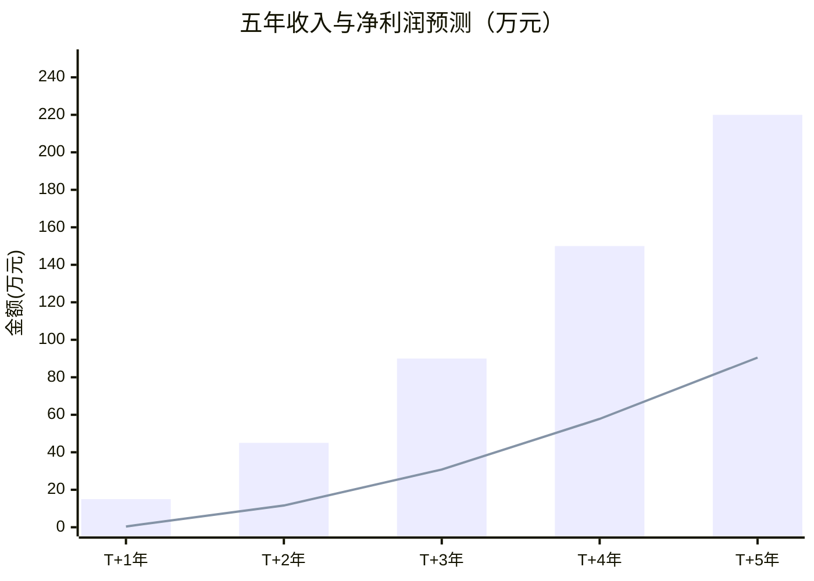

图 7-2 收入结构变化趋势

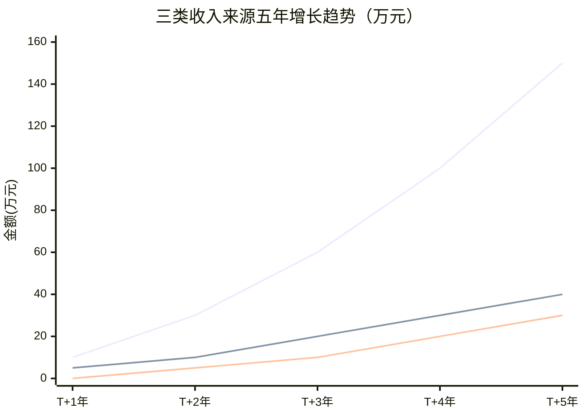

图 7-3 资金使用计划占比

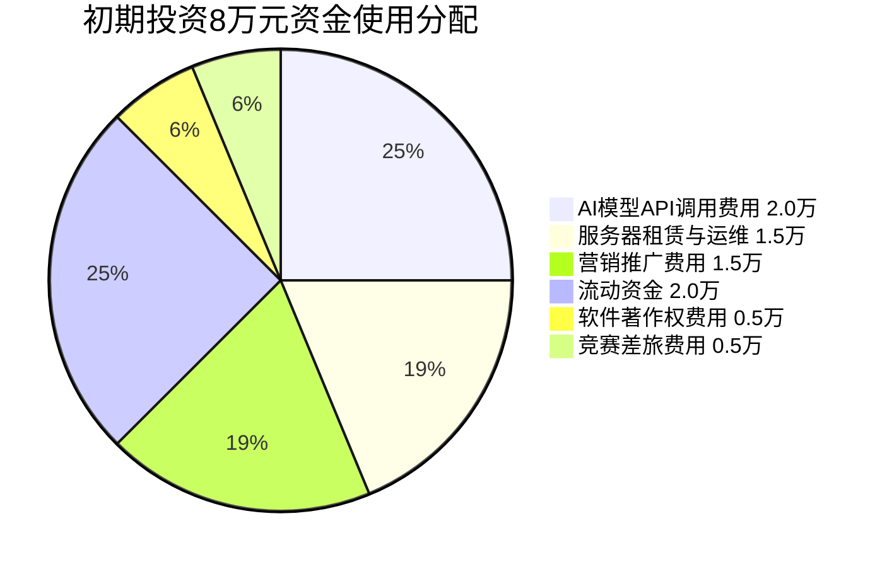

#### 7.5.2 分析结论

通过财务指标分析可以看出，项目具有较好的盈利能力和增长潜力。SaaS商业模式的高毛利特性、AI调用成本的持续下降趋势以及教育信息化市场的政策驱动增长，共同构成了项目良好的财务前景。初期投入仅需8万元，投资回收期短，适合大学生创业团队的资金条件。随着用户规模的扩大，规模效应将进一步提升利润率。
